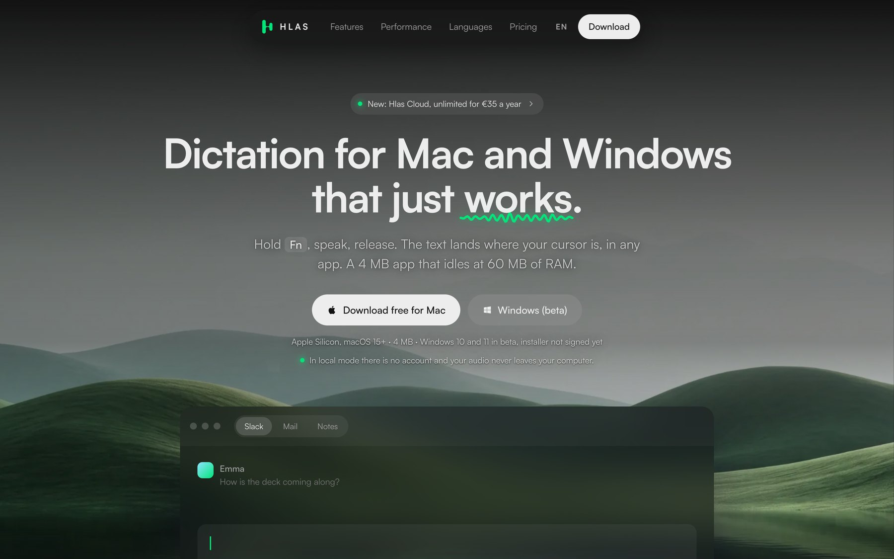
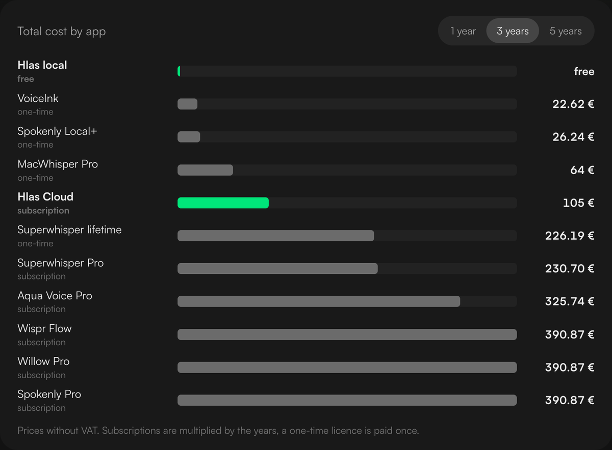
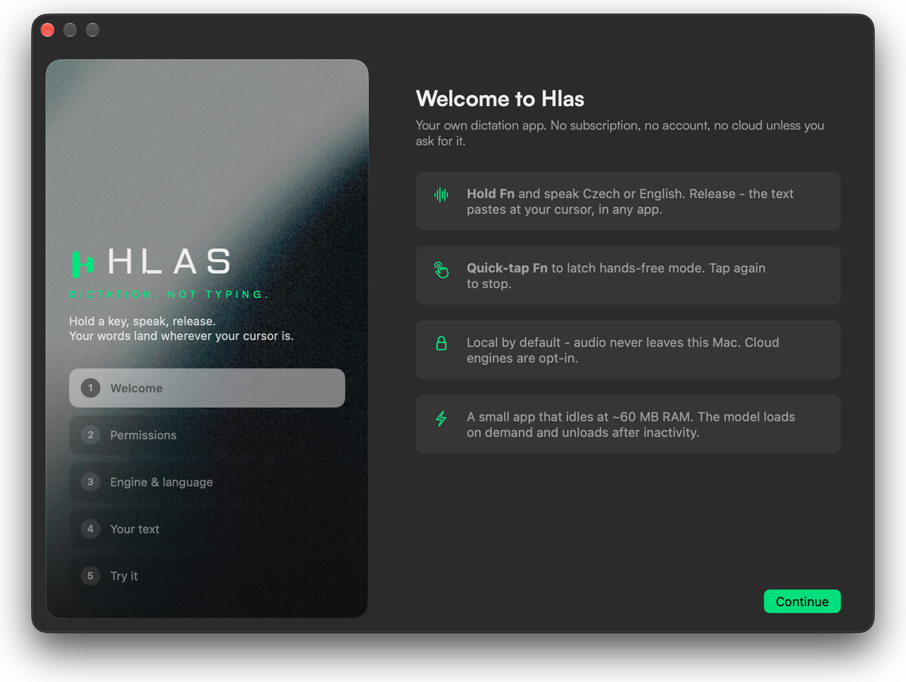
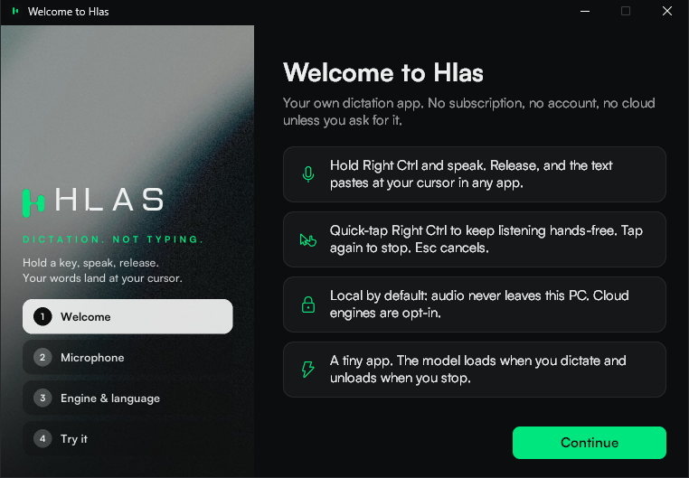
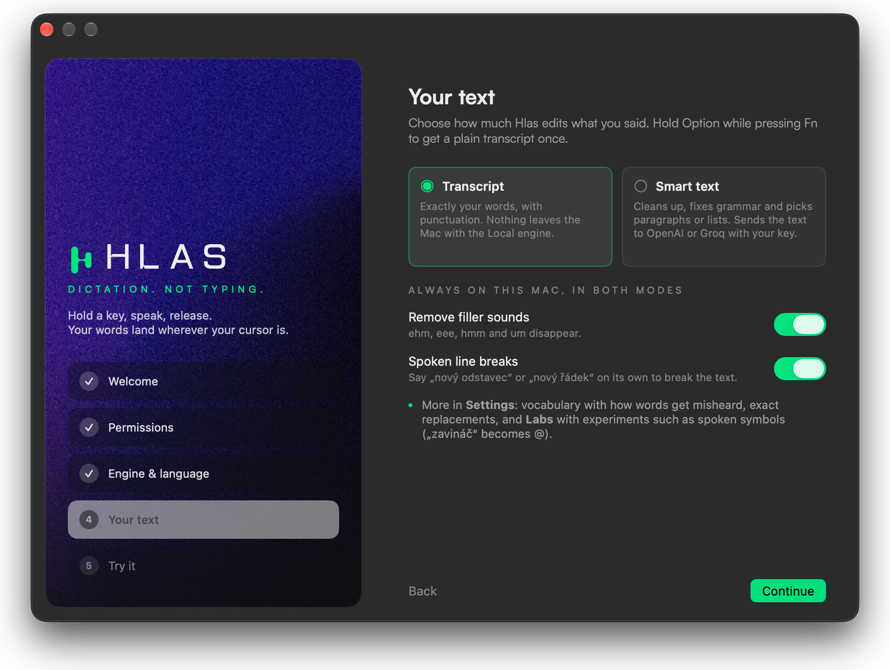
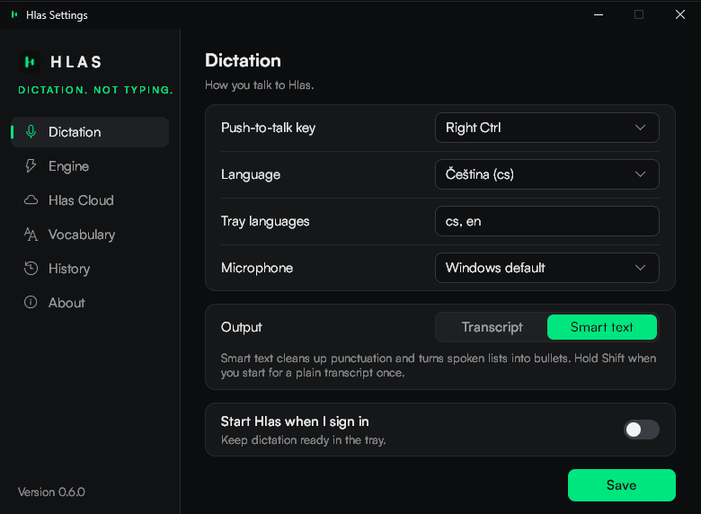

<div align="center">



# Hlas

**Dictation for Mac and Windows that just works.**

Hold **Fn**, speak, release. The text lands where your cursor is, in any app.
A 4 MB app that idles at 60 MB of RAM. Local mode is free, offline and needs no account.

### [⬇︎ Download for Mac](https://hlas.dev/download/Hlas-mac-arm64.dmg) &nbsp;·&nbsp; [Windows (beta)](https://hlas.dev/download/Hlas-windows-x64-setup.exe)

Apple Silicon, macOS 15+ · Windows 10 and 11 (x64, installer not code-signed yet)

**[hlas.dev](https://hlas.dev)** · [Hlas Cloud](https://hlas.dev/en/#pricing) · [Compare](https://hlas.dev/en/compare/) · [First run](#first-run) · [Build from source](#build) · [Privacy](docs/PRIVACY.md)

</div>

---

Built in Prague as a replacement for the $8-15 a month dictation apps, because every one of them treats Czech as an afterthought. Hlas speaks Czech, Slovak, English and the rest of the 60+ Whisper languages, and the website is in 40 of them.

## First run

1. **Mac:** open the DMG, drag **Hlas** onto **Applications** and open it. Grant **Microphone** (to hear you) and **Accessibility** (for the Fn key and the paste). The welcome tour walks you through both.
2. **Windows:** run the installer. Windows SmartScreen warns because the installer is not code-signed yet: click **More info**, then **Run anyway**. The default key is **Right Ctrl**.
3. Hold the key, speak, release.

Hlas for Mac is signed with the Developer ID certificate of Eden Makers s.r.o. and notarized by Apple. Every line of source is in this repo, and you can [build it yourself](#build).

<details>
<summary>Updating from a Mac build before October 2026?</summary>

Earlier builds were signed with a personal development certificate. The new signature makes macOS treat Hlas as a new app for permissions, so it asks for Microphone and Accessibility once more. If the Fn key does nothing after updating, remove Hlas from **System Settings → Privacy & Security → Accessibility** with the minus button and grant it again, or run:

```bash
tccutil reset Accessibility com.gedeon.hlas
```
</details>

<p align="center"></p>

## Three ways to transcribe

- **Local (default, free):** whisper.cpp `large-v3-turbo` on your computer (Metal on Mac). One-time 547 MB download, works offline, audio never leaves your computer. The model loads when you dictate and unloads after 3 minutes idle.
- **Hlas Cloud (35 € a year):** no keys, no model download, no word limit. 7 days free, no card. [Details on hlas.dev](https://hlas.dev/en/#pricing).
- **Your own key:** Groq (~$0.04 per hour of audio), OpenAI, Soniox or Fish Audio. Keys stay in the macOS Keychain or Windows Credential Manager.

## Stop renting your own voice

<p align="center"></p>

Prices without VAT, as listed by each vendor. Side-by-side pages for [Wispr Flow](https://hlas.dev/en/compare/hlas-vs-wispr-flow/), [Superwhisper](https://hlas.dev/en/compare/hlas-vs-superwhisper/), [MacWhisper](https://hlas.dev/en/compare/hlas-vs-macwhisper/), [VoiceInk](https://hlas.dev/en/compare/hlas-vs-voiceink/) and others, plus [the cheapest dictation app](https://hlas.dev/en/cheapest-dictation-app/), are on hlas.dev.

## One key. That's the whole UI.

- **Hold Fn** (Right Ctrl on Windows), speak, release: the text pastes into the focused app.
- **Quick-tap** the key to latch hands-free recording; tap again to stop (can be turned off in Settings). **Esc** cancels.
- **Ctrl+Option+V** (Mac) pastes your last dictation again.
- Tray or menu bar icon: **Settings**, **Vocabulary** and a searchable **History**.

| Mac | Windows |
|---|---|
|  |  |
|  |  |

## Transcript or Smart text

Choose **Transcript** to insert exactly what you said, with punctuation, or **Smart text** to clean up the dictation and pick readable paragraphs or lists. No style presets to manage. Smart text sends the text to OpenAI or Groq with your key, or runs through Hlas Cloud. Hold Option (Shift on Windows) when you start to get a plain transcript once.

Filler sounds (ehm, eee, hmm, um) and spoken line breaks ("nový řádek", "nový odstavec") are handled offline, in both modes. Originals stay in History. You can reprocess an entry, define exact text replacements, turn history off or set it to expire. The Mac menu also imports audio files up to 10 minutes long.

## A whole dictation app. Four megabytes.

- **~60 MB idle RAM:** Whisper loads on demand and unloads after 3 minutes of silence.
- **Keys stay in the system keychain:** history stays local and can be cleared anytime.
- **Bluetooth-safe:** pin the built-in mic so AirPods never wreck dictation quality.
- **Czech-first:** priming prompts for cs/sk/en, Czech-QWERTZ-safe paste.

## Repository layout

One repository, two native apps, one release:

| Path | What |
|---|---|
| `Sources/`, `Tests/`, `project.yml` | Hlas for macOS (Swift, AppKit/SwiftUI) |
| `windows/` | Hlas for Windows (Rust, Win32). Its own [README](windows/README.md) and [AGENTS.md](windows/AGENTS.md) |
| `windows/shared/hlas-shared.json` | Text rules both apps share, generated from the Swift sources; CI fails on drift |

Every GitHub release carries both apps under stable names, so `releases/latest/download/Hlas-mac-arm64.dmg` and `releases/latest/download/Hlas-windows-x64-setup.exe` always point at the newest build.

## Build

Prefer building it yourself? Two minutes:

```bash
# 1. Build whisper.cpp static libs (once)
cd ../hlas
make vendor   # builds whisper.cpp for the app's real macOS 15 deployment target

# 2. Build app (xcodegen: brew install xcodegen)
make install   # builds via Xcode (stable signing), installs to /Applications, launches
make test      # runs fast tests for WAV, filtering, errors, and model integrity
```

Permissions needed on first run: **Microphone** + **Accessibility** (for the Fn hotkey and paste).

Hlas supports Apple Silicon Macs running macOS 15 or later. Intel Macs are intentionally not supported in this release.

## Privacy

- **Local:** audio stays on the computer and is processed by the downloaded Whisper model.
- **Hlas Cloud:** audio goes to api.hlas.dev, which passes it to Groq for transcription. Audio is not stored. Details in [Privacy](https://hlas.dev/en/privacy/).
- **Groq / OpenAI / Soniox / Fish Audio:** audio is sent directly to the provider selected in Settings for transcription.
- API keys are stored in macOS Keychain. History stays local and can be cleared in Settings.

The full policy ships in the app and is available in [Privacy](docs/PRIVACY.md). See [third-party notices](THIRD_PARTY_NOTICES.md) for whisper.cpp, Whisper model, Satoshi, and Konect font licenses.

## Public release

`make install` is for local development. Two ways to cut a public DMG:

```bash
# Public releases: Developer ID (Eden Makers) + Apple notarization.
# One-time setup on the release Mac: the Developer ID Application cert of the
# Eden Makers account (tech@edenmakers.ai) in the login keychain, plus
xcrun notarytool store-credentials EdenNotary --apple-id tech@edenmakers.ai --team-id CLG46PZG7A
make release

# Fallback without those credentials: dev-signed, not notarized. Users then
# have to approve it in Privacy & Security. Do not publish these.
tools/release-unsigned.sh
```

`make release` creates an Apple Silicon DMG, notarizes it, staples the ticket, and checks Gatekeeper. It reads the distribution team off the installed Developer ID certificate, so the Eden Makers team never has to be written down next to the personal Apple Development team in `project.yml`. It intentionally stops if the required certificate or notarization credentials are unavailable. It also writes `dist/appcast.xml`, the Sparkle update feed, signed with the EdDSA key stored in the login Keychain (account `hlas`). Back that key up (`generate_keys --account hlas -x <file>` from Sparkle's `bin/`): without it no update can be signed for existing users.

Then publish one release for both apps:

```bash
tools/publish.sh
```

Once CI has attached the Windows installer, put both installers and the update feeds on hlas.dev, which is where the website, Sparkle and the Windows update check look:

```bash
tools/site-downloads.sh
```

`publish.sh` checks that `project.yml` and `windows/Cargo.toml` carry the same version, creates the GitHub release with the DMG, its checksum, the stable-named `Hlas-mac-arm64.dmg` and `appcast.xml`, and takes the notes from both changelogs. Publishing triggers the Windows workflow, which builds the same tag and attaches `Hlas-windows-x64-setup.exe` a few minutes later.

## Design

Fusion of the Fakturio design system (Linear/Raycast near-black neutrals, hairline borders, 16px radii) and the Eden Makers system (bio-digital green `hsl(153 100% 45%)`, uppercase tracked labels, never pure black/white).

The app uses a custom two-pulse Hlas mark and bundled Satoshi typography. The same mark scales from the macOS app icon down to the monochrome menu bar template.

## Architecture

```
Fn press ──► CGEventTap (Hotkey.swift, health-checked)
              │
              ▼
     AVCaptureSession ──► 16 kHz mono Float32 (AudioRecorder.swift)
              │                    │
              ▼                    ▼
      Overlay pill (NSPanel)   Transcriber protocol
                                 ├─ LocalWhisper (whisper.cpp, lazy load + idle unload)
                                 ├─ OpenAICompatibleTranscriber (Groq / OpenAI)
                                 ├─ SonioxTranscriber (upload, poll, delete)
                                 └─ FishAudioTranscriber
              │
              ▼
        TextInjector - pasteboard swap + Cmd-V (physical keycode 9,
        Czech-QWERTZ-safe), transient-tagged, changeCount-guarded restore
```

Techniques borrowed from studying Handy, VoiceInk and FluidVoice source:
hybrid tap/hold hotkey (VoiceInk), tap health-check (FluidVoice), clipboard
etiquette + sub-second padding + Czech filler handling (Handy).

## Credits

- Thinking orb in the status pill and on the website: [thinking-orbs](https://github.com/Jakubantalik/Libraries.dev) by Jakub Antalik, MIT licence (`web/vendor/thinking-orbs/LICENSE`).
