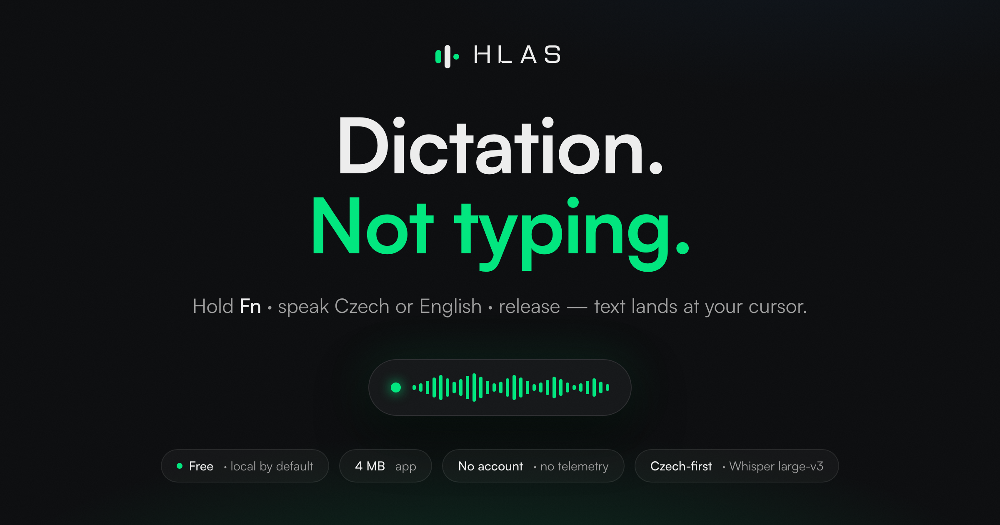
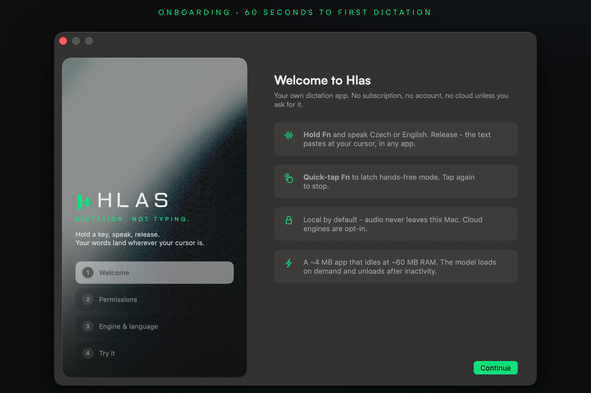
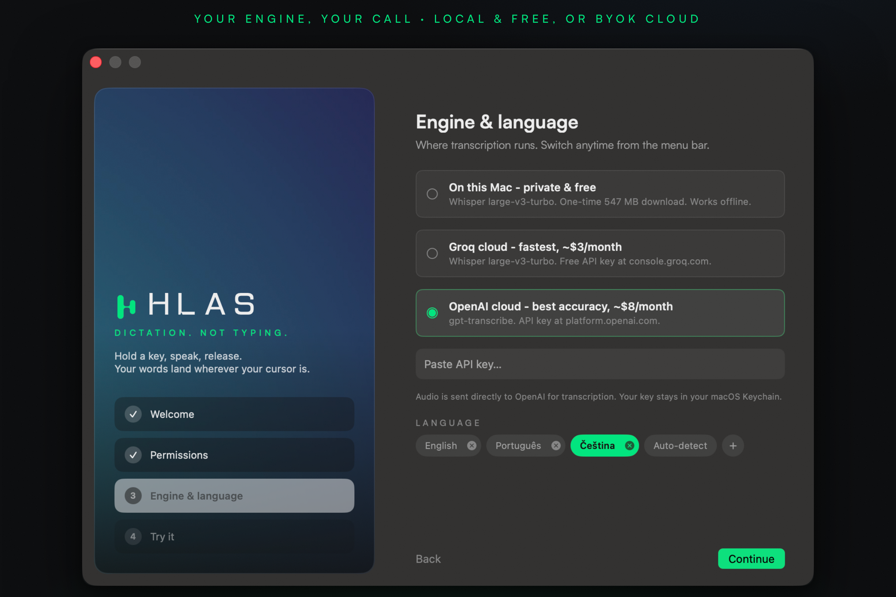
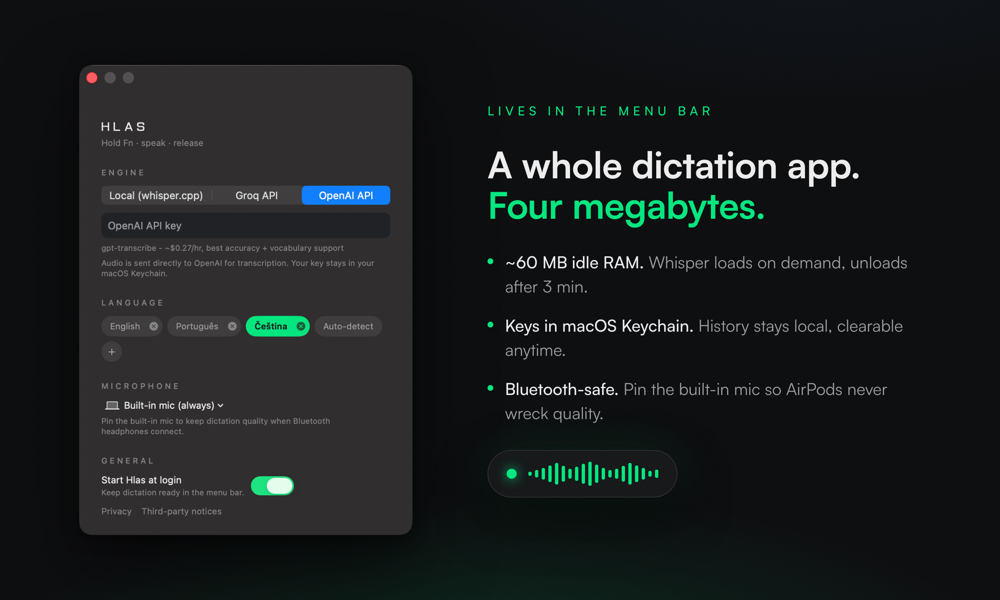

<div align="center">



# Hlas

**Dictation. Not typing.**

Hold **Fn** · speak Czech or English · release — text lands at your cursor, in any app.
No subscription. No account. No telemetry. No cloud unless you ask for it.

**[Website](https://gedeondrapak.github.io/hlas/)** · [Build it](#build) · [Privacy](docs/PRIVACY.md)

</div>

---

Built in Prague as a personal replacement for the $8–15/month dictation apps — because every one of them treats Czech as an afterthought, and none of them should cost more than your music streaming.

## Stop renting your own voice

| | **Hlas** | Superwhisper | Wispr Flow | Willow |
|---|---|---|---|---|
| Price | **free / ~$3/mo API** | $8.49/mo | $15/mo | $15/mo |
| Local + private | **yes** | yes | no (cloud + screenshots) | partial |
| Czech quality | **Whisper large-v3 class** | good | uncontrollable | weak |
| App size | **~4 MB** | ~1 GB+ | heavy | heavy |
| Idle RAM | **~60 MB** (model auto-unloads) | ~800 MB | heavy | ? |
| Account required | **no** | yes | yes | yes |

## One key. That's the whole UI.

- **Hold Fn** → speak → release: text pastes into the focused app.
- **Quick-tap Fn**: latches hands-free recording; tap again to stop.
- Menu bar Hlas icon → **Settings**, custom **Vocabulary**, searchable **History**.



## Your engine, your call

- **Local (default):** whisper.cpp `large-v3-turbo-q5_0` on Metal. One-time 547 MB download, ~1 GB RAM while loaded, auto-unloads after 3 min idle. Works offline. Audio never leaves your Mac.
- **Groq API:** whisper-large-v3-turbo — ~$0.04/hr of audio (≈ $1–3/mo at heavy use). BYOK.
- **OpenAI API:** gpt-transcribe — ~$0.27/hr, best accuracy + vocabulary support. BYOK.



## A whole dictation app. Four megabytes.



- **~60 MB idle RAM** — Whisper loads on demand, unloads after 3 minutes of silence.
- **Keys live in macOS Keychain** — history stays local and is clearable anytime.
- **Bluetooth-safe** — pin the built-in mic so AirPods never wreck dictation quality.
- **Czech-first** — priming prompts for cs/sk/en, Czech-QWERTZ-safe paste.

## Build

```bash
# 1. Build whisper.cpp static libs (once)
cd ../hlas
make vendor   # builds whisper.cpp for the app's real macOS 15 deployment target

# 2. Build app (xcodegen: brew install xcodegen)
make install   # builds via Xcode (stable signing), installs to /Applications, launches
make test      # runs fast tests for WAV, filtering, errors, and model integrity
```

Permissions needed on first run: **Microphone** + **Accessibility** (for the Fn hotkey and paste).

Hlas supports Apple Silicon Macs running macOS 15 or later. Intel Macs are intentionally not supported in this release.

## Privacy

- **Local:** audio stays on the Mac and is processed by the downloaded Whisper model.
- **Groq / OpenAI:** audio is sent directly to the provider selected in Settings for transcription.
- API keys are stored in macOS Keychain. History stays local and can be cleared in Settings.

The full policy ships in the app and is available in [Privacy](docs/PRIVACY.md). See [third-party notices](THIRD_PARTY_NOTICES.md) for whisper.cpp, Whisper model, and Satoshi font licenses.

## Public release

`make install` is for local development. A public DMG must be signed with a Developer ID Application certificate and notarized:

```bash
xcrun notarytool store-credentials HlasNotary --apple-id <email> --team-id <team-id>
make release
```

The release command creates an Apple Silicon DMG, notarizes it, staples the ticket, and checks Gatekeeper. It intentionally stops if the required certificate or notarization credentials are unavailable.

## Design

Fusion of the Fakturio design system (Linear/Raycast near-black neutrals, hairline borders, 16px radii) and the Eden Makers system (bio-digital green `hsl(153 100% 45%)`, uppercase tracked labels, never pure black/white).

The app uses a custom two-pulse Hlas mark and bundled Satoshi typography. The same mark scales from the macOS app icon down to the monochrome menu bar template.

## Architecture

```
Fn press ──► CGEventTap (Hotkey.swift, health-checked)
              │
              ▼
     AVCaptureSession ──► 16 kHz mono Float32 (AudioRecorder.swift)
              │                    │
              ▼                    ▼
      Overlay pill (NSPanel)   Transcriber protocol
                                 ├─ LocalWhisper (whisper.cpp, lazy load + idle unload)
                                 └─ OpenAICompatibleTranscriber (Groq / OpenAI)
              │
              ▼
        TextInjector - pasteboard swap + Cmd-V (physical keycode 9,
        Czech-QWERTZ-safe), transient-tagged, changeCount-guarded restore
```

Techniques borrowed from studying Handy, VoiceInk and FluidVoice source:
hybrid tap/hold hotkey (VoiceInk), tap health-check (FluidVoice), clipboard
etiquette + sub-second padding + Czech filler handling (Handy).
